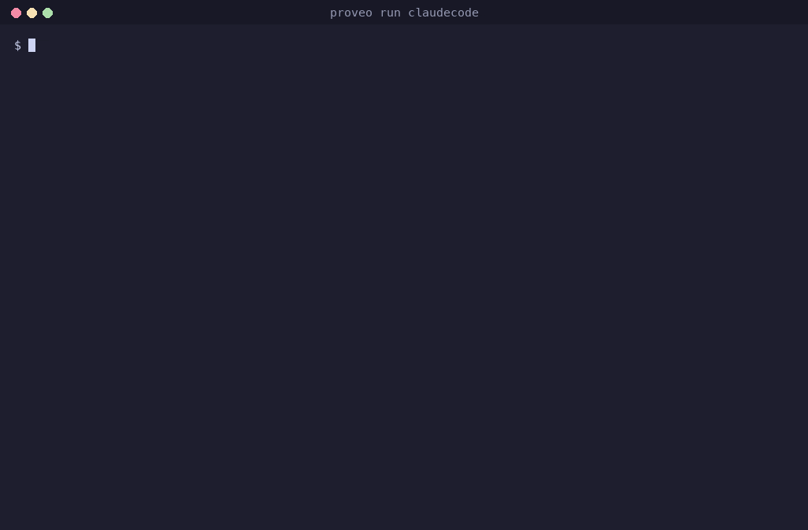

# Launch it

```sh
curl -fsSL https://proveo.ca/cli/install.sh | bash
```

<sub>Linux · macOS · FreeBSD. Windows: `irm https://proveo.ca/cli/install.ps1 | iex`. The installer ends with `proveo init`, which installs and signs in to [Docker Sandboxes](https://github.com/docker/sbx-releases) (sbx).</sub>



<sub>Claude Code startup captured in Docker Engine using the published image.</sub>

## How it works


`proveo run <agent>` starts the agent in an ephemeral sbx microVM, on a private clone of your repo.
sbx's proxy attaches your API keys, so the agent never holds them, and sbx's network policy decides
its egress. At teardown the agent's commits come home under `refs/proveo/<sid>`, and
`proveo adopt` turns them into a branch.

## Usage

Start an agent on the current repo with `proveo run <agent>` or the shorthand `proveo <agent>`.

```sh
proveo claudecode
```

Choose from `claudecode`, `codex`, `cursor`, `opencode`, and `hermes`.

Select **Browser → isolated fresh** or pass `--addon browser` to browse inside the sandbox.
Open the viewport URL from the run's interface to monitor the agent or take control and sign in.
Use `--browser-profile work` to keep that workspace's logins in a named sandbox between runs.
Use `--addon chrome` for sign-in flows that require Chrome on the host.

- `proveo init` sets up sbx and checks your machine.
- `proveo schedule` runs agents unattended from `~/.proveo/schedule.yml`.
- `proveo clean` reclaims resources left by interrupted runs.

## Contributing

`mise run ci` (lint + test) gates every change, `mise run test-images` and `mise run e2e [--full]` are the image and sbx gates, and `mise run build|deploy [target] [--cli]` builds and ships the images and the CLI; details in [`CONTRIBUTING.md`](CONTRIBUTING.md).
