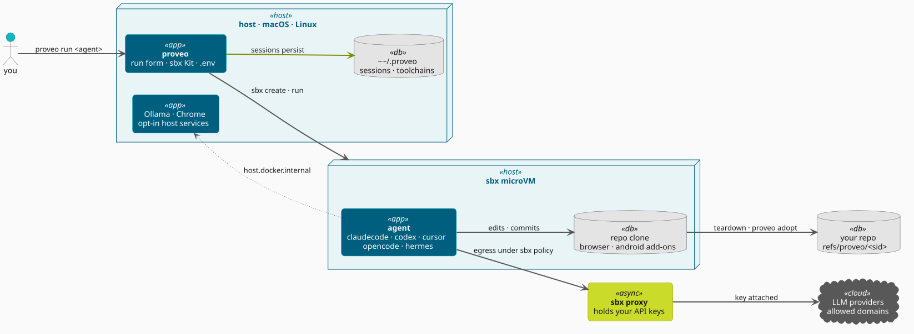

# Launch it

```sh
curl -fsSL https://proveo.ca/cli/install.sh | bash
```

<sub>Linux · macOS · FreeBSD. Windows: `irm https://proveo.ca/cli/install.ps1 | iex`. The installer ends with `proveo init`, which installs and signs in to [Docker Sandboxes](https://github.com/docker/sbx-releases) (sbx).</sub>


## How it works



`proveo run <agent>` starts the agent in an ephemeral sbx microVM, on a private clone of your repo.
sbx's proxy attaches your API keys, so the agent never holds them, and sbx's network policy decides
its egress. At teardown the agent's commits come home under `refs/proveo/<sid>`, and
`proveo adopt` turns them into a branch.

## Usage

```sh
proveo --help                      # every command, harness alias and help topic
```

| command | what it does |
| --- | --- |
| `proveo run [agent]` | Start an agent on the current repo; `proveo <agent>` does the same. `--scope <dir>` picks a sub-project, `--addon browser\|chrome\|desktop\|android` adds an interface, `--local-model <tag>` serves the model from the host's Ollama, `--credentials broker\|forward` decides who holds the key, `--resume <id>` · `--continue` · `--ls` pick a session, `--print` shows the sbx command, `--yes` skips the form. |
| `proveo ls` | List the harness targets: claudecode, codex, cursor, opencode, hermes and their variants. |
| `proveo init` | Install and sign in to sbx, check this host, ready git and gh. `--print` shows the plan; `--yes` takes the defaults. |
| `proveo projects` | List the monorepo sub-projects `--scope` takes. |
| `proveo adopt [ref]` | Create a branch from the commits a run carried home; with no argument, list them. |
| `proveo rm [sandbox]` | Carry a kept sandbox's work home, then remove it; with no argument, list them. `--stop` stops a running one first. |
| `proveo attach [task]` | Open a running scheduled task's terminal; `-r` watches without typing. |
| `proveo schedule` | Run agents unattended at set times from `~/.proveo/schedule.yml`: `ls`, `run`, `retry`, `attach`, `install`, `uninstall`. |
| `proveo clean` | Reclaim what crashed runs left. `--deep` adds images, `--tools` toolchains, `--homes` `~/.proveo`; `--dry-run` previews. |
| `proveo setup` | Add proveo's directory to your shell's PATH. |
| `proveo update` | Install the latest release from the CDN; `--check` only reports. |
| `proveo uninstall` | Remove proveo, its PATH lines and its prompt kit; `--yes` skips the question. |
| `proveo version` | Print the version. |
| `proveo help env` | List every `PROVEO_*` variable with its default and effect. |

## Contributing

`mise run ci` (lint + test) gates every change, `mise run test-images` and `mise run e2e [--full]` are the image and sbx gates, and `mise run build|deploy [target] [--cli]` builds and ships the images and the CLI; details in [`CONTRIBUTING.md`](CONTRIBUTING.md).
