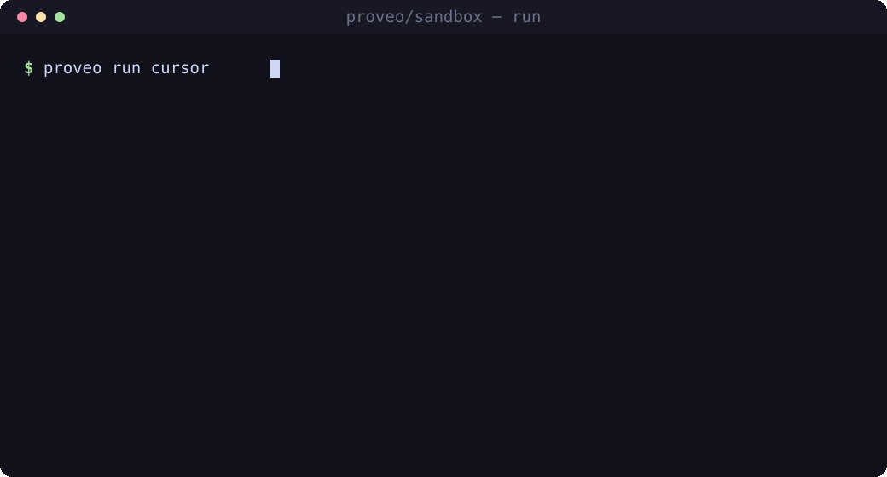
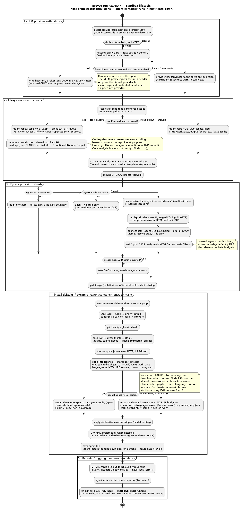

# proveo/sandbox

> Portable, hardened Docker sandboxes for AI coding agents — one command, any repo.



<sub>The capability picker on `e2e/samples`. Record a live terminal version with `vhs _spec/_assets/hero.tape`.</sub>

`proveo run <agent>` drops a coding agent (opencode, Claude Code, Codex, Cursor, cecli) into an
**ephemeral [Docker Sandboxes](https://github.com/docker/sbx-releases) (sbx) microVM** scoped to
your repo — with sbx's network policy on egress, sbx's credential proxy keeping API keys **out of
the agent**, opt-in Playwright/browser and Docker-in-Docker, and local-model support where the
harness allows it. No per-tool setup.

## Install

```sh
curl -fsSL https://proveo.ca/cli/install.sh | bash      # Linux · macOS · FreeBSD
```
```powershell
irm https://proveo.ca/cli/install.ps1 | iex             # Windows
```

Checksum-verified static binaries (amd64 + arm64). After install: `proveo version`,
`proveo update --check`, `proveo uninstall`.

The installer ends by running `proveo init`, which readies the **backend** proveo runs on. It
prompts for anything still open; `PROVEO_SKIP_INIT=1` opts out.

### Ready the host

```sh
proveo init                 # prompt, install the pinned sbx, check this host, sign in
proveo init --print         # what it would do, changing nothing
proveo init --yes           # take the defaults without prompting
```

`proveo init` prepares the backend, not your repository. It detects OS and architecture,
installs the pinned [Docker Sandboxes](https://github.com/docker/sbx-releases) release
(v0.42.0) under `~/.docker/sbx` without root — verifying the download against the digest the
release publishes, where one covers it — then runs `sbx login`, `sbx setup`, and reports whether
the daemon is actually up. On a terminal it asks first: rootless tarball or distro package,
which prefix, whether to write your shell rc, sign in now or later, and whether to bind the
host-wide network baseline (the one thing it never changes on its own).

It also names the host conditions that otherwise fail *late*, as a sandbox that dies with no
output: no `/dev/kvm`, a user outside the `kvm` group, no `e2fsprogs`, SELinux enforcing (the
release bundles an AppArmor profile and nothing for SELinux — and the RPM package is **not** a
fix for it either; measured 2026-09-07, an enforcing host still died instantly). A condition
that only blocks *running* does not block installing — `usermod -aG kvm` needs a re-login that
`init` cannot perform for you.

sbx is the only backend. Without a ready sbx — no CLI, Linux without `/dev/kvm`, an unsupported
platform, or a release older than proveo targets — `proveo run` first offers to install or upgrade
sbx where it can, then refuses with the install or upgrade command. `--print` refuses without
offering.

### Publish a CLI release

```bash
git tag -a v0.1.0 -m "…"
git push origin v0.1.0          # optional but good
mise run deploy-cli
```

On an exact tag this builds multi-arch binaries (goreleaser, no GitHub Release), stages
`latest.json` + checksums into `apps/cli/public/cli`, and deploys to Cloudflare via Wrangler.
Details: [`apps/cli/README.md`](apps/cli/README.md).

## Quickstart — try it on the sample

The repo ships a **polyglot monorepo sample** (Go API · Rust harness · Bun/TS TUI · TS workspace
package) at [`e2e/samples/`](e2e/samples) — the same workspace the E2E suite drives.

```bash
cd e2e/samples

proveo run opencode                          # capability picker (Tab: browser / agent evidence), then boots
proveo run cursor                            # Cursor inference is vendor-pinned; sbx's proxy holds the key
proveo run opencode --local-model gemma4     # fully local on the host's Ollama — no cloud key
```

`proveo run` opens a **capability picker** — *press tab to add an option (browser, Claude in
Chrome, agent evidence), or enter to continue* — then launches the agent against your repo with the guarantees
below. Agents run at their most verbose by default: thoughts, tool calls and diffs on screen
([`CODING_HARNESSES.md`](CODING_HARNESSES.md#agent-evidence)).

## Supported languages & tooling

Detected in your workspace and provisioned on demand — nothing is baked into every image.

       

Detection is monorepo-aware: it walks the invocation scope to depth 7, pruning dependency
and build trees (`node_modules`, `vendor`, `target`, `dist`, …) so a dependency's
`Dockerfile` is never mistaken for the workspace's own. The registry lives in
`cmd/proveo/main.go` (`toolingMarkers`) and is the single source of truth for both these
pills and the first-run choice prompt.

## Agents & variants

| Agent | Images | Notes |
| --- | --- | --- |
| **opencode** | `opencode` · `opencode-browser` | subagent crew; native LSP; `--local-model` |
| **Claude Code** | `claudecode` (+ `-solidity`, `-browser`) | MCP / Solidity toolchain; subscription auth (Anthropic) |
| **Codex** | `codex` · `codex-browser` | same loop as Claude Code; ChatGPT-plan login or `OPENAI_API_KEY`; LSP over MCP |
| **Cursor** | `cursor` · `cursor-browser` | vendor-pinned inference; subscription auth |
| **cecli** | `cecli` | aider fork (Python); `--local-model` |

`-browser` variants add **Playwright + Chromium** (opt-in via the picker, sharing one Chromium
layer).

**Local models** (`--local-model`): the model runs on the **host's Ollama**, which the sandbox
reaches at `host.docker.internal:11434`; proveo pulls a missing tag before launch. Cursor is
vendor-pinned (rejected). See [`_spec/internal/sbx/host-inference.puml`](_spec/internal/sbx/host-inference.puml).

**Subscription agents** (claudecode, codex, cursor): proveo warns if auth env is missing and
lets the agent handle login; after the sandbox exits it prints shell-specific setup hints
(`.env` or a safe host location). Prefer host env / project `.env` over in-sandbox login tokens.

## How it works

Every run is a host-orchestrated, ephemeral sandbox: detect provider auth → mount the repo →
write the sbx Kit → boot the agent → record + tear down.



## Security — egress & credentials

Two independent axes, both handled by sbx.

**Egress** follows sbx's host-wide network policy. proveo never sets it; the picker's `egress` row
shows the baseline read-only.

```sh
sbx policy reset && sbx policy init allow-all|balanced|deny-all   # host-wide baseline
sbx policy allow network <domain>                                 # allow one more domain
sbx policy ls                                                     # active rules
sbx policy log                                                    # allowed and blocked hosts
```

proveo writes no egress allowlist of provider or harness hosts into the sbx Kit. The Kit allows only
the host services an add-on wires up (host Ollama, host Chrome CDP, host adb) and the domains where
sbx attaches a stored credential, which sbx requires there. On a `balanced` or `deny-all` host,
allow your provider's domains with `sbx policy allow network <domain>` if the agent cannot reach
them. Each run saves `sbx policy log` to `sbx/policy-log.json` in its run directory.

**Credentials** follow `--credentials`:

| mode | where the key lives |
| --- | --- |
| `broker` (default) | sbx's secret store; sbx's proxy attaches it to matching requests, so the agent never holds it |
| `forward` | the sandbox environment; the agent holds the real value |

proveo reads the project `.env` on the host and seeds its values into a new sandbox with
`sbx create --env-file`: provider keys stay out under `broker` and ride along under `forward`.
The image itself never loads a `.env`. The values are set when the sandbox is created;
`sbx rm --force <sandbox>` reseeds them on the next run.

## Proveo home (session resume)

Agent sessions and seeded home config persist under `~/.proveo/` (override with
`PROVEO_HOME`). A sandbox sees only its harness's declared subdirectories and `toolchains`,
each at its host path; the home itself is never mounted. Host IDE homes are never mounted;
login token files listed in each harness `home.mounts.deny` are scrubbed before every run.

A symlink inside a declared subdirectory is followed, read-only, only when its absolute
target is listed in `~/.proveo/linked-dirs` (one path per line, `#` for comments); every
other link is reported at launch and left unfollowed.

| Harness | Host path | Resume |
| --- | --- | --- |
| cursor | `~/.proveo/.cursor` | `proveo run cursor --resume <id>` / `--continue` / `--ls` |
| claudecode | `~/.proveo/.claude` | `proveo run claudecode --resume <id>` / `--continue` |
| codex | `~/.proveo/.codex` | `proveo run codex --resume <id>` / `--continue` / `--ls` |
| opencode | `~/.proveo/opencode/v2/config` (history lives in the engine) | `proveo run opencode --resume <session-id>` |
| cecli | `~/.proveo/.cecli` | home conf only (project state stays in `/app/.cecli`) |
| hermes | `~/.proveo/hermes/data`, bound as `HERMES_HOME` (sessions, memories, skills) | survives `sbx rm` |

Routine `proveo clean` leaves this cache alone; reclaim with `proveo clean --homes`.

## Environment variables

`proveo help env` lists every `PROVEO_*` variable a user or maintainer sets, with its default
and effect. On/off switches take `1|true|yes|on|enable|enabled` or
`0|false|no|off|disable|disabled`.

## Specs

Architecture, the sbx network-policy baseline, testing strategy, and the
[Docker-Sandbox experiment](_spec/_experiments/docker-sandbox.puml) live in [`_spec/`](_spec)
as PlantUML diagrams + notes. Conventions: [`CONVENTIONS.md`](CONVENTIONS.md).
